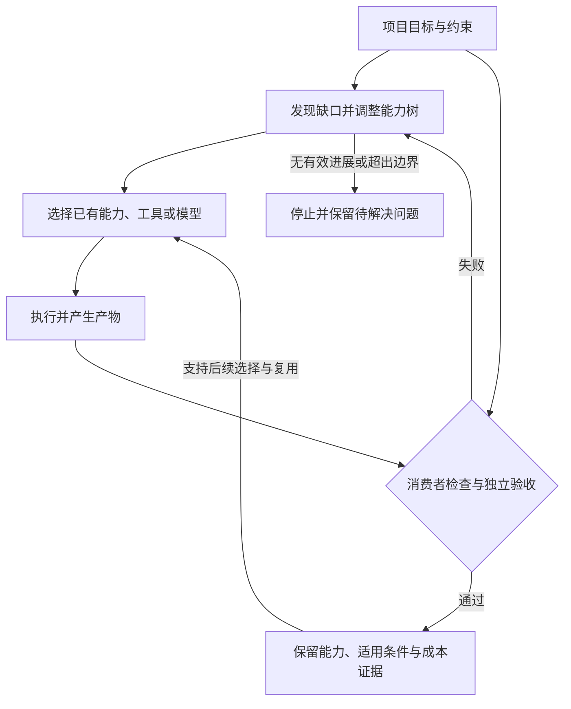

# VeriArbor 项目简介

**让能力围绕真实项目生长，并以可信反馈持续改进。**

[返回项目首页](../README.md) · [架构与实现边界](ARCHITECTURE.md) · [实验性 API](PUBLIC_API.md)

> 当前阶段：Research Preview / Alpha。本文介绍完整项目愿景，并单独说明当前公开实现。公开包提供部分基础策略；完整自主能力生长、生产驱动选模及其端到端收益仍需持续验证。

## 一、VeriArbor 是什么

VeriArbor 探索一种围绕真实任务持续构筑和复用能力的 Agent 系统。系统以项目目标为起点，建立并调整能力树，识别执行过程中出现的能力缺口，构筑新的可执行组件，并按需要组合、替换、修剪和复用已有能力。

跨供应商模型选择是这一过程的一部分。项目希望根据任务类型、项目结构、语言、模型版本、风险和已有证据，为不同工作选择合适的模型或工具，并优化包含生产、检查、修复与恢复在内的完整交付成本。

生产者、消费者与独立验收共同检查实际产物，帮助发现错误假设、幻觉和执行偏航。通过验收的能力及其适用条件可以被保留；失败、变化和不确定结果则成为后续修正与选择的依据。

项目的设计理念是：**一个项目可以随着需求和反馈逐步长出必要的能力，同时保持目标清晰、边界明确、结果可核查。** 这里的“生长”发生在系统的组件、工具组合、项目状态与经验中，不要求基础模型的参数随之更新。

## 二、项目关注的问题

VeriArbor 围绕以下问题开展设计与验证：

- **能力无法完全预先枚举。** 项目执行中可能出现新的需求、依赖和失败模式，需要决定何时继续分解、构筑新组件，或换一种实现方式。
- **工作完成与目标达成之间存在距离。** 命令执行成功、文件存在或生产者自测通过，都不能单独证明用户要求已经满足。
- **错误假设可能贯穿整条链路。** 规划、实现和检查如果共享同一错误前提，多轮自我修改也可能持续偏离目标。
- **需求变化容易造成重复工作。** 局部修改后，需要判断哪些结果失效、哪些仍然适用，以及判断依据是否充分。
- **模型选择受到任务和完整成本影响。** 调用单价、模型通用排名或供应商品牌，不能单独决定某项工作的经济性。
- **执行经验难以可靠迁移。** 一次成功有特定输入、版本、环境和验收条件；将它无条件推广到其他任务，可能积累错误经验。

项目希望把这些问题放在同一个交付过程中处理：能力构筑决定需要做什么，资源选择决定由谁做，验收决定是否做好，真实结果再影响下一次决策。

## 三、核心方向一：能力树自主生长

能力树用于表达目标、子目标和能力缺口。执行依赖可以形成 DAG，同一个能力也可以被多个分支引用。树形目标结构与共享执行依赖可以共存。

### 生长包括哪些动作

| 动作 | 设计目标 |
|---|---|
| 发现缺口 | 判断现有能力是否足以满足当前目标，以及缺少什么 |
| 构筑能力 | 生成新的实现，或组合已有组件形成可执行方案 |
| 调整分解 | 根据任务难度、失败证据和执行成本，决定进一步拆分或合并 |
| 实际消费与验收 | 让下游真正使用产物，并取得适用于当前版本的验收证据 |
| 替换与修剪 | 修复局部实现，结束无效分支，淘汰过期经验，避免无界增长 |
| 保留与复用 | 保留有用能力及其适用条件，在后续任务中重新判断是否可用 |

任务树增加节点只代表计划发生了变化。只有新方案能够执行、满足目标并被实际使用，才能说明系统在相应条件下补齐了能力。

### 以叶子积木和接口控制复杂度

叶子能力以 Block 表达。输入、输出、业务语义及副作用共同构成其边界；不同实现可以作为候选 Variant，在满足相关条件后替换。

局部实现变化时，设计目标是保留仍然适用的结果，只处理确实受影响的范围。但输入输出字段相同，并不证明业务行为相同；文件写入、共享状态、顺序、并发和外部副作用，也可能改变消费者的使用条件。

因此，组件替换需要当前实现的验收依据，证据复用需要明确的适用范围。缺少依据时，应扩大检查或保持未知。公开策略的具体限制见 [Port 兼容性](PORT_COMPATIBILITY.md) 和 [组件替换](SUBSTITUTION.md)。

### 生长必须有停止条件

目标已经满足、现有能力足够、重复尝试没有新信息，或成本与风险超出边界时，系统应当结束相应分支。必要能力和验收义务不能为了缩短上下文而被删除。

项目关注的是有用能力的积累，以及复杂度能否被控制；节点数量、Agent 数量和调用次数本身不构成进展指标。

## 四、核心方向二：按任务选择合适的模型与工具

VeriArbor 的长期选模目标是：在满足交付质量和其他约束的前提下，为当前工作选择完整成本合理的执行方式。候选资源可以是不同供应商的模型、已有能力组件或确定性工具。

### 选择需要结合项目上下文

计划考虑的因素包括：

- 任务类型、能力边界、复杂度和下游影响；
- 编程语言、输入/提示语言、输出语言，以及仓库文档和混合语言环境；
- 模型的实际身份、版本、服务条件及已经证实的版本继承关系；
- 当前工具、上下文、预算、时延和风险约束；
- 独立验收结果、修复路径、失败归因与估计的不确定性。

任务分解与模型选择需要共同考虑。边界明确的局部工作可能适合较低成本的模型；强耦合或需要全局判断的工作，可能值得使用能力更强的模型。已经稳定的步骤可以复用既有代码和工具。

### 以完整交付成本衡量经济性

成本范围包含规划、生成、工具执行、验收、失败、修复、恢复及人工介入。低单价如果伴随更多返工，未必带来更低的交付成本；额外检查和路由本身的开销也需要计入。

跨供应商选择是一项设计原则。项目不假定某个厂商一定最优，也不以其他厂商不会提供路由作为竞争前提。需要验证的是：项目结构和可信生产反馈能否改善具体工作的资源分配。

### 从真实生产中学习

真实任务原则上只安排一次生产历程，以形成可用交付为目的。正常验收、有界修复与必要恢复属于该历程，全部保留并计入成本。不同模型可以承担不同真实任务，不依赖重复生产同一完整项目来建立排名。

这也意味着学习必须保留不确定性：观察到一个模型的结果，不能直接说明未选模型会怎样；不同难度的任务不能仅用原始成功率比较。模型版本和任务条件变化后，旧经验需要重新判断适用性，未知故障不能强行归因于模型能力。

完整的生产驱动选模、版本/语言适应及统计策略仍是研究与集成方向；本公开预览不宣称已经提供成熟的最优模型路由系统。

## 五、核心方向三：以可信反馈控制偏航

验证机制服务于能力生长和实际交付。不同角色与模型可以提供额外视角，最终仍需尽量用可检验的产物、环境结果和业务要求形成判断。

### 分层检查不同问题

| 检查层次 | 关注的问题 |
|---|---|
| 生产者自测 | 实现能否运行，局部功能是否符合已知约束 |
| 消费者检查 | 上游产物能否被下游实际使用，语义和效果是否满足需求 |
| 局部组合检查 | 多个组件连接后，行为和副作用是否仍符合约定 |
| 独立业务验收 | 当前交付是否满足原始目标及公开的必要要求 |

同一模型的自我评价、多个模型的一致意见，都不能自动替代独立业务验收。检查器也可能出错，因此需要与目标对应的样例、边界条件及必要的正反例，而不能仅重复实现中的假设。

### 让证据对应当前对象

验收证据需要关联相应的产物、契约、检查器、版本及适用条件。旧产物的成功不能直接转移给新实现；变化后的结果需要新的适用依据。

当前公开策略提供这类绑定、替换与复用判断的基础，但证据认证和实际检查由 Host 承担。策略对象和派生视图本身不是独立签名，也不是完整真值来源。详见 [架构](ARCHITECTURE.md)、[算法限制](ALGORITHM.md) 和 [组件替换](SUBSTITUTION.md)。

### 修正过程要保留真实状态

失败应触发有依据的定位、局部修复或重新规划。缺失证据、待人工评价和执行结果未知需要被明确保留，不能为了结束流程而转换成成功。

局部检查通过后，仍需关注组合效果和最终目标。系统不能通过修改用户目标、删除必要要求或放宽验收来制造完成状态。

## 六、完整生命周期：设计目标

下图描述项目希望实现的闭环，不表示当前公开包已经包含所有运行时能力。

执行、持久化、预算、权限和恢复需要明确的权威归属。当前库采用薄策略层，避免同时引入第二套执行器、状态库和账本。宿主系统负责实际调用与副作用，策略层提供受条件约束的判断。

## 七、适用研究场景与能力生长示例

项目优先关注需要持续迭代、可以取得实际执行反馈的软件工具、数据与媒体处理流程，以及由多个能力组件协作完成的自动化任务。需求变化、局部复用和模型分工能否产生收益，需要在具体场景中验证。

以下是设计示例，不代表已完成实验或已测得收益。

目标是制作一个带字幕的视频导出工具。系统已经具备视频读取、字幕解析和导出能力，但在验收中发现长字幕遮挡了被讲解对象。

1. **定位缺口：** 判断问题属于字幕布局，而不是直接重写整个视频处理流程。
2. **构筑能力：** 生成或组合一个字幕布局组件，明确输入区域、字体、文字内容及输出约束。
3. **选择执行资源：** 根据该局部任务的复杂度和已有经验选择模型，复用现有解码与导出工具。
4. **真实使用：** 让导出步骤消费新布局的结果，生成实际视频。
5. **验收与修正：** 检查字幕可读性、遮挡、时间对应、音轨和播放情况；必要时只修复相关部分。
6. **沉淀能力：** 保留通过验收的实现及适用条件。未来更换字体、分辨率或布局要求时，重新判断哪些证据仍适用。

该示例同时体现能力构筑、模型分工、消费者检查和局部变化处理。是否真的节省成本，需要结合实际运行、检查与维护开销验证。

## 八、当前公开实现与愿景的边界

本节依据当前仓库公开代码与文档，说明读者现在可以获得什么。

| 范围 | 当前公开状态 |
|---|---|
| Block / Port / Contract / Effects / Variant | 提供纯 Python 策略与数据结构，围绕可替换能力和明确边界组织判断 |
| 证据绑定、组件替换、验证去重、局部影响判断 | 提供受限策略 API；需要 Host 提供合格证据、当前版本及作用域依据，库本身不执行或认证检查 |
| 图、生命周期、搜索和学习等原语 | 部分 API 属于兼容层或可选实验，不能将其存在等同于完整自主能力生长或生产选模已经完成 |
| 规划、执行、模型调用、持久化与计费 | 由 Host 承担；当前公开库不包含完整项目执行运行时 |
| Host 调度与复验节省 | 公开预览保持 `SHADOW_ONLY` 边界；不宣称已在生产中减少复验或实现净成本收益 |
| Promotion Studio | 仓库附带独立应用；它不导入 `veriarbor`，应用通过不能自动证明策略库或完整 Host 闭环有效 |
| 正式信任与生产可用性 | 当前为 Alpha；P11 正式信任锚和独立签名尚未部署，已有安全暂停边界仍需遵守 |

代码、测试与版本范围以 [项目首页](../README.md)、[架构](ARCHITECTURE.md)、[实验性 API](PUBLIC_API.md)、[已知问题](KNOWN_FAILURES.md) 和 [发布测试摘要](RELEASE_TEST_SUMMARY.md) 为准。测试通过、独立业务验收通过、用户体验认可及正式可信交付分别描述。

## 九、如何判断项目是否产生价值

项目希望通过可复查的真实产物回答以下问题：

- **新能力是否有效：** 发现缺口后，能否构筑出实际可执行、被下游消费且满足要求的能力？
- **修改是否更可控：** 需求变化后，能否准确识别失效范围，保留仍然有效的工作，并避免错误复用？
- **资源分配是否改善：** 在满足质量要求的情况下，完整交付成本、耗时或人工负担是否改善？
- **经验是否可迁移：** 适用条件相近的新任务能否受益，版本或条件变化时能否识别不确定性？
- **复杂度是否受控：** 无效分支、重复生成和过时经验能否被识别并结束？

评估应保留首次交付、必要修复、失败、UNKNOWN 和人工介入，区分共用准备成本与任务成本。隐藏验收可以隐藏具体样例与预期值，但不能隐藏业务要求。

影子策略建议省略某些检查时，需要与实际完整检查核对。实际账本包含全部已执行工作；潜在可省范围与已经实现的净收益分别报告。少量项目只支持相应案例结论，不能把节点或断言数量当作独立项目样本。

## 十、研究与工程推进方向

以下按验证问题组织，不构成时间或性能承诺：

1. **把构筑与真实交付连起来。** 检查目标、能力调整、实际委派、产物消费与最终验收之间的关联。
2. **验证局部变化机制。** 研究稳定边界、消费者作用域和证据有效性，观察错误复用与过度失效。
3. **积累可归因的生产反馈。** 区分模型、工具、框架、任务规格与验收问题，保留版本和成本依据。
4. **逐步改进任务与模型分配。** 在数据支持的范围内研究语言、任务结构、版本变化和不确定性；简单规则与复杂策略都需要比较实际收益。
5. **研究长期能力积累。** 检查组件复用、组合、修剪和经验更新能否持续改善项目迭代，同时控制维护成本。

## 十一、相关工作与进一步阅读

动态分解、技能积累、模型路由和评价修正已有研究与工程实践。VeriArbor 以这些方向为背景，探索围绕项目目标、能力边界和生产证据的组合方式，不将这些通用机制宣称为项目首创。

- [ADaPT: As-Needed Decomposition and Planning with Language Models](https://aclanthology.org/2024.findings-naacl.264/)：按执行需要递归分解任务，为动态调整任务结构提供研究背景。
- [Voyager: An Open-Ended Embodied Agent with Large Language Models](https://arxiv.org/abs/2305.16291)：在 Minecraft 环境中通过可执行技能库和环境反馈积累能力；其环境结果不直接证明软件项目中的效果。
- [Building effective agents — Anthropic](https://www.anthropic.com/research/building-effective-agents)：介绍路由、动态委派、评价优化及环境反馈等工程模式。
- [RouteLLM](https://github.com/lm-sys/RouteLLM)：模型路由的开源研究与实现，可作为理解质量与成本权衡的参考。

## 十二、从哪里开始

- 想理解完整目标：阅读本文的能力生长、模型选择和验证反馈三部分。
- 想试用公开包：使用 [README 的快速开始](../README.md#quick-start-library)。
- 想理解集成责任：阅读 [架构](ARCHITECTURE.md)、[公开 API](PUBLIC_API.md) 和 [算法限制](ALGORITHM.md)。
- 想研究替换与局部变化：阅读 [Port 兼容性](PORT_COMPATIBILITY.md) 和 [组件替换](SUBSTITUTION.md)。
- 想了解附带应用：阅读 [Promotion Studio](../apps/promotion_studio/README.md) 及其独立限制。

欢迎围绕明确的场景、可复现的反例、验收依据和完整成本提出问题或改进。库的使用遵循仓库 [MIT License](../LICENSE)；附带应用的许可与来源说明见其对应目录。
